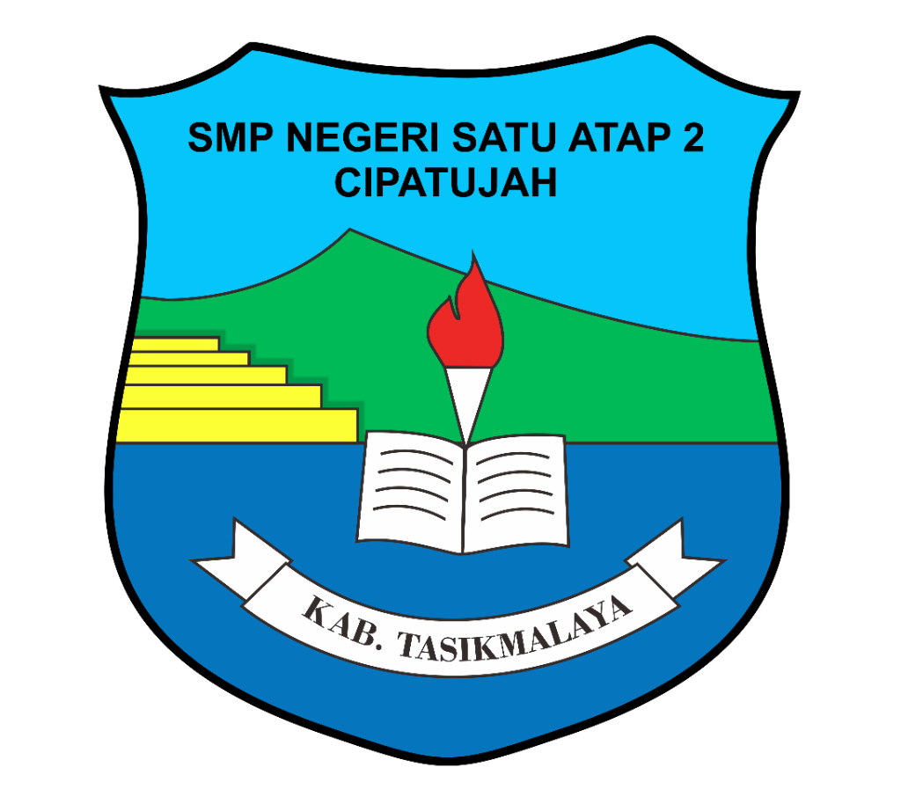

# DADO CBT v1.5.3 (FIXED)

<div align="center">



### **Gabungan Aplikasi Rapor, Ujian CBT Standar AKM, dan E-Learning**
**SMP NEGERI SATU ATAP 2 CIPATUJAH — KAB. TASIKMALAYA**

[](https://www.php.net/)
[](https://mariadb.org/)
[](https://nginx.org/)
[](https://ubuntu.com/)
[](#desain-visual--aksesibilitas)
[](#pengujian--verifikasi-sistem)

</div>

---

## 📖 Tentang Aplikasi

**DADO CBT** adalah platform asesmen dan manajemen pembelajaran terpadu berbasis web yang dibangun ulang (*rebuilt*) dari repositori standar **GarudaCBT v1.5.3 (FIXED)**. Aplikasi ini dirancang menggunakan arsitektur MVC modular berkecepatan tinggi tanpa ketergantungan framework yang berat, sehingga sangat efisien dalam penggunaan memori dan CPU.

Sistem telah dioptimalkan secara khusus untuk menangani konkurensi tinggi dengan target **1.000 peserta ujian serentak** melalui penerapan *single-row atomic AJAX saves*, *composite indexing* pada tabel transaksi, pengacak urutan *Fisher-Yates*, serta *caching* aset statis.

---

## 🌟 Fitur Unggulan

### 1. Bank Soal & Asesmen 5 Tipe AKM
- **Pilihan Ganda Tunggal**: Opsi jawaban dinamis (3, 4, atau 5 opsi) yang menyesuaikan jenjang sekolah.
- **Pilihan Ganda Kompleks**: Multi-jawaban berbasis array JSON dengan penilaian proporsional.
- **Menjodohkan (Matching)**: Kanvas tarik garis interaktif (*SVG Line Connector*) untuk teks, gambar, maupun gambar tanpa teks.
- **Isian Singkat**: Koreksi otomatis dengan normalisasi *case-insensitive* dan *auto-trim*.
- **Uraian / Essai**: Dilengkapi editor jawaban siswa dan antarmuka input poin koreksi guru.
- **Persamaan Rumus & Bahasa**: Dukungan render rumus matematika **LaTeX (KaTeX)**, font teks Arab **Arabic Calibri**, dan editor **Summernote**.
- **Import Dokumen**: Mengimpor butir soal dan gambar langsung dari berkas **Word (.docx)** dan **Excel (.xlsx/.csv)**.

### 2. Engine Pelaksanaan Ujian (Exam Engine)
- **Timer Sinkron Waktu Server**: Menggunakan *server-sent baseline* untuk mencegah manipulasi jam lokal perangkat.
- **Fitur Lembar Ujian**: Tombol Zoom In / Zoom Out ukuran teks soal, navigasi soal, dan indikator ragu-ragu.
- **Single-Device Session Lock**: Mencegah akun siswa digunakan login di dua perangkat atau browser secara bersamaan.
- **Anti-Cheat Detection**: Deteksi otomatis perpindahan tab browser atau jendela aplikasi (`visibilitychange` & `window.blur`) dengan peringatan dan penguncian sesi ujian.

### 3. Monitoring & Administrasi Pengawas
- **Live Status Siswa**: Dashboard pemantauan real-time status siswa (Belum Mulai, Sedang Ujian, Selesai) lengkap dengan filter Kelas, Ruang, dan Sesi.
- **Aksi Pengawas / Admin**: Reset Login, Reset Waktu Ujian, Paksa Selesai, dan Ulang Ujian (membersihkan nilai lama).
- **Cetak Dokumen Administrasi**: Kartu Peserta Ujian, Daftar Kehadiran Siswa, dan Berita Acara Ujian (defensive escaping terhadap tanda petik).
- **Koreksi & Analisis**: Menu koreksi lembar jawaban, analisis butir soal, fitur **Katrol / Konversi Nilai**, serta **Export Rekap Nilai Excel Dinamis** (struktur kolom rapi meskipun tanpa soal PG).

### 4. E-Learning & Presensi KBM
- **Jadwal Pelajaran KBM**: Matriks jadwal mengajar mingguan per kelas dengan jam mulai, durasi JP, dan istirahat.
- **Materi & Tugas**: Penerbitan materi belajar dan penugasan dengan lampiran berkas dan video. Akses terisolasi ketat sesuai mapel yang diampu oleh guru.
- **Ruang Belajar Siswa**: Antarmuka membaca materi, pengumpulan tugas, forum diskusi/komentar, dan pencatatan presensi harian otomatis ke tabel `log_materi` saat diakses pada jam KBM.
- **Rekap Hasil**: Koreksi tugas, rekap presensi harian, rekap presensi bulanan, dan ekspor Excel rekap nilai e-learning.

### 5. E-Rapor, DKN, & Buku Induk
- **Pengaturan Rapor**: Konfigurasi KKM tunggal/multi, pembobotan nilai (PH, PTS, PAS), predikat otomatis, dan kompetensi dasar (KI/KD).
- **Kumpulan Nilai Rapor**: Sinkronisasi 1-klik nilai harian dari KBM dan nilai ujian CBT, input nilai Sikap Spiritual & Sosial, Ekstrakurikuler, Absensi, Catatan Wali Kelas, Kesehatan/Fisik, Prestasi, dan Kenaikan Kelas.
- **Cetak Dokumen Rapor**: Generator cetak **Rapor PTS**, **Rapor Akhir Semester (PAS/PAT)**, dan **Daftar Kumpulan Nilai (DKN)** berstandar cetak A4/F4.
- **Buku Induk & Alumni**: Pengarsipan otomatis riwayat nilai lintas semester dan pencatatan status alumni siswa.

### 6. Utilitas Basis Data & Web Installer
- **Backup & Restore Database**: Pembuatan berkas cadangan `.sql` penuh dan pemulihan data transaksional.
- **Database Update**: Fitur verifikasi otomatis kelengkapan 42 tabel relational sesuai skema PRD tanpa menghapus data yang ada.
- **Web Installer Wizard**: Pemandu instalasi 5 langkah di `/installer/` untuk konfigurasi lingkungan, database, dan akun admin.

---

## 🎨 Desain Visual & Aksesibilitas

DADO CBT mengadopsi identitas resmi **SMP Negeri Satu Atap 2 Cipatujah** dengan palet warna kontras tinggi yang memenuhi standar **WCAG AA Compliance**:
- **Background Utama**: Slate Navy (`#0f172a`) & Putih Bersih (`#ffffff`).
- **Warna Identitas (Logo)**: Ocean/Sky Blue (`#0284c7`), Mountain Green (`#059669`), dan Gold Steps Accent (`#d97706`).
- **Keterbacaan Teks**: Rasio kontras teks utama terhadap background minimal 7:1 untuk memastikan kenyamanan mata siswa saat ujian berdurasi panjang.

---

## 🚀 Panduan Instalasi di VPS Ubuntu 24.04 / 22.04 LTS

Telah disediakan skrip **Autoinstaller Otomatis** yang sangat mudah dijalankan dalam 2 langkah cepat:

### Langkah Pemasangan Termudah (Rekomendasi):
Login ke VPS via SSH (`ssh root@ip-vps`), lalu jalankan:

```bash
# 1. Clone repository ke VPS dan masuk ke foldernya
git clone https://github.com/<username-anda>/<repo-anda>.git dadocbt
cd dadocbt

# 2. Jalankan skrip autoinstall (cukup tekan ENTER saat muncul pilihan mode)
sudo bash autoinstall.sh
# atau: sudo ./autoinstall.sh
```

> [!TIP]
> **Express 1-Click Install:**
> Saat skrip berjalan, sistem otomatis mendeteksi IP VPS Anda dan menampilkan pilihan `[1] Express Install`. Cukup tekan **[ENTER]**, skrip akan otomatis memasang dan mengonfigurasi Nginx, PHP 8.3-FPM, MariaDB, firewall UFW, impor 42 tabel relational, serta menyiapkan akun admin default (`admin` / `admin123`) tanpa perlu mengetik parameter rumit!

> [!NOTE]
> **Fitur Clean Reset (Masa Test):**
> Installer dilengkapi opsi pembersihan otomatis untuk menghapus database pengujian dan folder lama sebelum memasang versi baru, sehingga server selalu dalam kondisi bersih (*fresh clean install*).

---

## 🔄 Alur Auto-Update GitHub & Push Otomatis

Tersedia mekanisme terintegrasi untuk memperbarui kode dari laptop/komputer Anda ke GitHub dan VPS:

```
[Komputer Lokal / Windows]
        │
        ▼  Double-click "autopushgithub.bat"
 [GitHub Repository]
        │
        ▼  Webhook (push event)
 [VPS Ubuntu 24.04]  ──> Auto Backup DB ──> Git Pull ──> Migrate 42 Tabel ──> Restart PHP-FPM
```

### 1. Upload ke GitHub dari Windows (`autopushgithub.bat`)
Cukup klik dua kali berkas **`autopushgithub.bat`** di folder utama proyek:
1. Skrip akan mendeteksi Git, menginisialisasi branch `main`, dan meminta URL repository GitHub Anda jika belum diatur.
2. Menampilkan status berkas yang berubah sesuai proteksi `.gitignore` (file sensitif seperti `.env` tidak akan terunggah).
3. Melakukan `git add`, `git commit` dengan pesan otomatis bertanggal, dan `git push -u origin main`.

### 2. Auto-Update Otomatis di Server via GitHub Webhook
1. Buka repository GitHub Anda di browser, masuk ke menu **Settings** > **Webhooks** > **Add webhook**.
2. Isi formulir:
   - **Payload URL**: `https://cbt.domain-anda.sch.id/webhook.php` *(atau `http://IP_VPS/webhook.php`)*
   - **Content type**: `application/json`
   - **Secret**: Masukkan nilai `GITHUB_WEBHOOK_SECRET` dari file `.env` (atau lihat di menu Admin *Utilitas Database*).
   - **Events**: Pilih *Just the push event*.
3. Klik **Add webhook**. Setiap ada `git push`, server VPS Anda akan otomatis ter-update dalam beberapa detik!

### 3. Perintah Singkat CLI di VPS
Setelah instalasi selesai di VPS, perintah-perintah berikut dapat dijalankan kapan saja di terminal:

| Perintah Terminal | Kegunaan |
| :--- | :--- |
| `sudo dadocbt-update` | Menjalankan pembaruan kode GitHub, backup database pra-update, & migrasi skema. |
| `sudo dadocbt-backup` | Membuat backup basis data terkompresi `.sql.gz` dengan rotasi otomatis >30 hari. |
| `sudo dadocbt-status` | Memeriksa status Nginx, PHP-FPM, MariaDB, RAM, disk, & jumlah siswa aktif CBT. |
| `php scripts/migrate.php` | Menjalankan verifikasi dan migrasi 42 tabel relational tanpa menghapus data. |

---

## 💻 Menjalankan di Lingkungan Lokal (Localhost / XAMPP)

Jika ingin menjalankan aplikasi di komputer lokal (Windows / macOS / Linux):

1. **Prasyarat Perangkat Lunak:**
   - PHP 8.2 atau 8.3 dengan ekstensi: `pdo_mysql`, `curl`, `mbstring`, `gd`, `zip`.
   - MariaDB 10.6+ atau MySQL 8.0+.
   - Apache atau Nginx (atau PHP Built-in Server).

2. **Pengaturan Konfigurasi `.env`:**
   Salin berkas `.env.example` menjadi `.env`, lalu sesuaikan koneksi database Anda:
   ```env
   APP_NAME="DADO CBT"
   APP_ENV=development
   APP_URL=http://localhost:8080

   DB_HOST=127.0.0.1
   DB_PORT=3306
   DB_NAME=garudacbt
   DB_USER=root
   DB_PASS=""

   SESSION_COOKIE_NAME=dadocbt_session
   ```

3. **Inisialisasi Database:**
   Impor berkas skema dan data awal ke server MySQL Anda:
   - `database/schema.sql` (struktur 42 tabel dan composite index)
   - `database/seed.sql` (akun admin default, tahun pelajaran, semester, jenis ujian)

4. **Jalankan Server PHP:**
   ```bash
   php -S 0.0.0.0:8080 -t public
   ```
   Akses melalui browser di [`http://localhost:8080/`](http://localhost:8080/).

---

## 🔑 Kredensial Login Default

| Portal Akses | URL | Username Default | Password Default |
| :--- | :--- | :--- | :--- |
| **Portal Administrator** | `/login` | `admin` | `admin123` |
| **Portal Dewan Guru** | `/login` | `guru` | `guru123` |
| **Portal CBT Siswa** | `/cbt/login` | `2025001` *(atau `siswa`)* | `siswa123` |
| **Pemandu Instalasi** | `/installer/` | *(Setup Baru)* | *(Setup Baru)* |

---

## 📁 Struktur Direktori Proyek

```
dado-cbt/
├── app/
│   ├── Config/             # Konfigurasi Database, Auth, dan Konstanta Jenjang
│   ├── Controllers/
│   │   ├── Auth/           # Login Staf & Login CBT Siswa
│   │   ├── Master/         # TP, Semester, Jurusan, Mapel, Siswa, Guru, Kelas
│   │   ├── Elearning/      # Jadwal KBM, Materi, Tugas, Presensi & Nilai
│   │   ├── Cbt/            # Ruang, Sesi, Bank Soal, Jadwal, Token, Status, Koreksi
│   │   ├── Rapor/          # KKM, KIKD, Input Nilai, Catatan Wali, Cetak Rapor, Buku Induk
│   │   ├── Student/        # Dashboard Siswa, Ruang Belajar, & Exam Engine CBT
│   │   └── Settings/       # Profil Sekolah, Manajemen User, Utilitas Database
│   ├── Core/               # Router, Request, Response, Controller, Session, Database
│   ├── Helpers/            # Helper fungsi global (Tanggal Indo, Escaping, Fisher-Yates)
│   ├── Middlewares/        # AuthMiddleware, GuestMiddleware, RoleMiddleware
│   ├── Models/             # 42 Model entitas tabel database
│   └── Services/           # Randomizer Fisher-Yates, AutoGrader AKM, Rapor, DB Backup
├── database/
│   ├── schema.sql          # Skema DDL 42 tabel relasional & composite indexes
│   └── seed.sql            # Data awal (seeder) pengguna dan konfigurasi
├── deploy/
│   ├── install-vps.sh      # Skrip instalasi otomatis VPS Ubuntu 24.04/22.04
│   ├── update.sh           # Skrip auto-update penarik kode GitHub
│   ├── backup.sh           # Utilitas backup database gzip terotasi
│   ├── status.sh           # Utilitas pemantau status kesehatan server
│   └── README.md           # Panduan lengkap deployment server
├── public/
│   ├── assets/             # CSS (High Contrast), JS, KaTeX, WebFonts, & Logo
│   ├── installer/          # Web Installer Wizard 5 langkah
│   ├── uploads/            # Direktori penyimpanan foto siswa, guru, materi, & tugas
│   ├── index.php           # Front Controller & Bootstrapper aplikasi
│   └── webhook.php         # GitHub Webhook Auto-Update Listener
├── scripts/
│   └── migrate.php         # CLI Database Migration Runner
├── tests/
│   ├── test_milestone5.php # Test suite engine ujian CBT & Anti-Cheat (43 tests)
│   └── test_milestone6.php # Test suite E-Rapor, DKN, & Buku Induk (49 tests)
├── autoinstall.sh          # Auto Installer VPS (Cukup: git clone lalu sudo bash autoinstall.sh)
├── autopushgithub.bat      # Auto Push 1-klik untuk Windows
├── .gitignore              # Proteksi berkas sensitif (.env, backups, logs)
└── README.md               # Dokumentasi utama proyek
```

---

## 🧪 Pengujian & Verifikasi Sistem

Aplikasi telah divalidasi menggunakan suite pengujian otomatis terintegrasi:

```bash
# Uji Engine Ujian CBT, Randomizer Fisher-Yates, AutoGrader, & Anti-Cheat:
php tests/test_milestone5.php
# Hasil: 43 PASSED, 0 FAILED

# Uji Pengaturan Rapor, KKM, Sinkronisasi Nilai, DKN, Buku Induk, & Backup SQL:
php tests/test_milestone6.php
# Hasil: 49 PASSED, 0 FAILED
```
**Total:** **92 Pengujian Otomatis Lulus 100% tanpa kegagalan.**

---

## 📄 Lisensi & Hak Cipta

Dikembangkan khusus untuk **SMP Negeri Satu Atap 2 Cipatujah**, Kab. Tasikmalaya, Jawa Barat.  
Hak Cipta dilindungi undang-undang.
